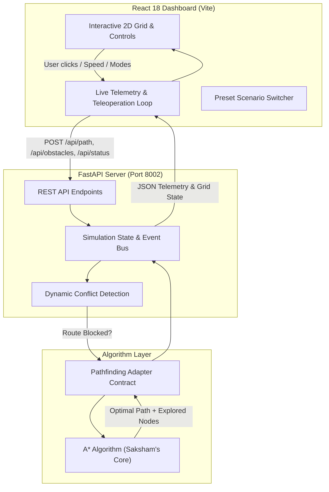

# VisionNav AI — Intelligent Autonomous Robot Navigation & Dynamic Obstacle Avoidance

[](https://hackinhills.com)
[](https://fastapi.tiangolo.com/)
[](https://react.dev/)
[](https://vitejs.dev/)
[](#)
[](https://python.org)

> **Submission for Hack in Hills ’26 (AI & Robotics Track)**  
> Engineered by **Shivam** (Backend, Integration & Simulation), **Saksham** (A* Pathfinding), and **Vaishnavi** (Presentation & Pitch Deck).

---

## 🚀 Overview

**VisionNav AI** is a simulation-first autonomous robot navigation platform engineered for dynamic, unpredictable environments. In real-world applications—such as warehouse automated guided vehicles (AGVs), automated mobile robots (AMRs), and disaster search-and-rescue—static pathfinding is insufficient. Robots frequently encounter moving objects, fallen debris, or sudden obstructions.

VisionNav AI pairs an optimized **A\* (A-Star) search algorithm** with a **reactive dynamic replanning engine**. When an obstacle suddenly blocks the robot's active trajectory, the system detects the conflict on-the-fly, recalculates an alternative collision-free route from the robot's current coordinates, and continues navigation without human intervention. If all paths become blocked, an automated safety failsafe halts the robot and triggers an operator alert.

---

## 🌟 Key Features

- **Dual-Mode A\* Pathfinding:** Toggle between 4-directional Manhattan distance search and 8-directional Diagonal Octile search with strict diagonal corner-cutting prevention.
- **A\* Search Frontier Heatmap:** Visualizes the closed-set evaluated nodes on the live grid, demonstrating how the heuristic prunes the search space.
- **Line-of-Sight Path Smoothing:** String-pulling post-processor using Bresenham raycasting to eliminate staircase zig-zags across open space.
- **Continuous Drag-to-Draw Wall Brush:** Click and drag across the grid to draw continuous obstacle walls or erase them in real time.
- **Real-Time Dynamic Obstacle Avoidance:** Place obstacles directly in front of the robot while it is moving; the backend detects the blockage and recalculates a detour seamlessly.
- **⚡ One-Click Dynamic Obstacle Injection:** A dedicated `⚡ Drop Obstacle on Route` control drops an obstacle 1–2 steps ahead of the moving robot to instantly demonstrate real-time replanning.
- **Unreachable Destination Failsafe:** Detects when all routes to the goal are blocked, immediately halts traversal, and alerts the user with an actionable warning banner.
- **Live Telemetry & Dashboard:** Tracks active route length, progress percentage, explored nodes, total obstacles, dynamic replan count, and live robot states.
- **Preset Scenarios:** Instant switching between **Default Arena**, **Maze Challenge**, **Corridor Detour**, **Unreachable Trap Test**, and **Clear Canvas**.
- **Variable Simulation Speed:** Traversal rate adjustable from 60ms to 600ms per step with quick presets (Slow, Normal, Fast).

---

## 📐 Architecture & Workflow



---

## 👥 Team & Responsibilities (Hack in Hills ’26)

| Member | Primary Role | Key Contributions |
|---|---|---|
| **Shivam** | Backend Lead & Full-Stack Integration | FastAPI backend architecture, REST endpoints, dynamic obstacle detection, simulation loop, state synchronization, input validation, integration tests, and submission management. |
| **Saksham** | Pathfinding & Algorithm Specialist | A* search algorithm implementation, priority queue tie-breaking, Manhattan heuristic optimization, and path reconstruction contract. |
| **Vaishnavi** | Presentation & Design Lead | Hackathon pitch deck, PPT slides, problem statement narrative, user experience alignment, and presentation delivery. |

---

## 🛠️ Tech Stack

- **Backend:** Python 3.10+, FastAPI, Uvicorn, Pydantic v2
- **Algorithm:** A* Search with Priority Queue (`heapq`), Manhattan Distance Heuristic ($f(n) = g(n) + h(n)$)
- **Frontend:** React 18, Vite, Lucide React Icons, Modern CSS (Glassmorphism & Cyberpunk Theme)
- **Testing:** Pytest, AnyIO, PowerShell API Smoke-Test Script

---

## ⚡ Quick Start & Installation

### 1. Prerequisites
- **Python 3.10+** (Python 3.11 or 3.12 recommended)
- **Node.js 18+** and **npm**

---

### 2. Backend Setup

Open a PowerShell or Bash terminal in the project directory:

```powershell
# Navigate into backend directory
cd visionnav_backend_shivam

# Create and activate Python virtual environment
py -m venv .venv
.\.venv\Scripts\Activate.ps1   # On Linux/macOS: source .venv/bin/activate

# Install dependencies
pip install -r requirements.txt

# Launch FastAPI development server
uvicorn backend.main:app --reload --port 8002
```

> **Verification:**  
> Open your browser at `http://127.0.0.1:8002/` to view health status, or `http://127.0.0.1:8002/docs` for the Swagger API documentation.

---

### 3. Frontend Setup

Open a **second terminal**:

```powershell
# Navigate into frontend directory
cd visionnav_backend_shivam\frontend

# Install node dependencies
npm install

# Start Vite development server
npm run dev
```

> **Dashboard Access:**  
> Open `http://127.0.0.1:5173` in your browser. The dashboard will automatically connect to the backend on port 8002.

---

## 🧪 Testing & Verification

### Unit & API Test Suite
Run the 14 automated unit and integration tests:

```powershell
# From the visionnav_backend_shivam directory with venv activated
pytest -v
```

**Test Coverage Highlights:**
- `test_health_and_map`: Verifies server health and 12×16 grid dimensions.
- `test_calculate_path`: Verifies A* path generation from start to destination.
- `test_blocked_start_rejected`: Ensures blocked start coordinates return HTTP 400.
- `test_invalid_obstacle_request_is_atomic`: Confirms invalid requests do not partially corrupt the map.
- `test_dynamic_obstacle_triggers_replan`: Confirms adding an obstacle on an active route triggers automatic replanning and increments the replan counter.
- `test_unreachable_destination_reported`: Verifies that trapped goals return `status: "unreachable"` with zero path.
- `test_dynamic_spawn_endpoint`: Tests the one-click dynamic obstacle injection.
- `test_presets_loading`: Verifies switching across scenario presets.
- `test_status_update_tracks_steps`: Validates telemetry tracking of robot movement steps.

### PowerShell Smoke Test
To test all endpoints sequentially:
```powershell
.\tools\test_api.ps1
```

---

## 📡 API Contract

| Method | Endpoint | Description | Request Body Example |
|---|---|---|---|
| `GET` | `/` | Service health & algorithm metadata | None |
| `GET` | `/api/map` | Full grid state, robot, goal, route, and telemetry | None |
| `POST` | `/api/path` | Calculate optimal path using A* | `{"start": [1, 1], "goal": [10, 14]}` |
| `POST` | `/api/obstacles` | Add/remove walls; auto-replanning if path blocked | `{"add": [[3, 5]], "remove": []}` |
| `POST` | `/api/obstacles/dynamic-spawn` | Drops obstacle 1–2 steps ahead of robot | None |
| `POST` | `/api/replan` | Recalculate route from current robot position | None |
| `POST` | `/api/status` | Update robot coordinates and state telemetry | `{"robot": [1, 2], "status": "moving"}` |
| `POST` | `/api/presets` | Switch scenario (`default`, `maze`, `corridor`, `trap`, `clear`) | `{"preset": "maze"}` |
| `POST` | `/api/reset` | Reset simulation to initial clean state | None |

---

## 🎬 Demo Scenarios Walkthrough

### Scenario 1: Standard Optimal Pathfinding
1. Select the **Default Arena** preset.
2. Click **Find Optimal Route (A\*)**.
3. Observe the calculated path (22 steps) navigating around obstacles.
4. Click **Start Movement Simulation** to watch the robot traverse cell by cell.

### Scenario 2: Real-Time Dynamic Obstacle Avoidance
1. While the robot is moving along its route, click **⚡ Drop Obstacle on Route** (or use the **Add Wall** tool to click directly on the glowing green path ahead).
2. The conflict detection engine catches the blockage in real time.
3. The robot halts momentarily, calculates an alternative route around the obstacle, increments the **Dynamic Replans** counter, and resumes toward the goal!

### Scenario 3: Trapped / Unreachable Destination
1. Switch to the **Unreachable Trap Test** scenario from the top dropdown.
2. Notice the goal is walled off on three sides.
3. Add a wall on the remaining opening `[10, 14]`.
4. Click **Find Optimal Route**.
5. The system displays a prominent red warning banner: **"DESTINATION UNREACHABLE"** and stops all movement safely.

---

## 📋 Hack in Hills ’26 Submission Checklist

- [x] **Complete Source Code:** Full FastAPI backend, React dashboard, and A* algorithm.
- [x] **Automated Tests:** 14/14 passing pytest suite + smoke test script.
- [x] **Comprehensive Documentation:** Architecture diagram, setup instructions, and API contracts.
- [ ] **GitHub Repository:** Make repository public and paste link in submission form.
- [ ] **Demo Video:** Record 2-minute walkthrough showing scenarios 1, 2, and 3.
- [ ] **LinkedIn Post:** Publish project breakdown tagging Eren, Builder Base, Nexido, and Web3 India.
- [ ] **Instagram Reel:** Post 45-second highlight reel explaining project and hackathon motivation.
- [ ] **Google Form Submission:** Submit all 4 links before the hackathon deadline.

---

## 📄 License

This project was created for **Hack in Hills ’26** and is licensed under the MIT License.
